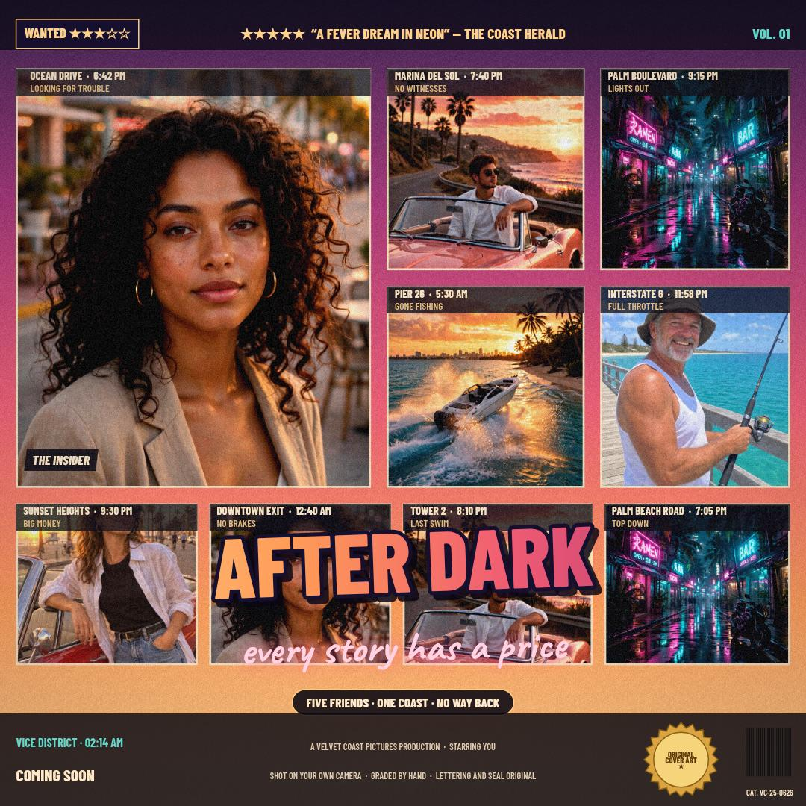

# Velvet Coast — Cover Studio

[](https://make.fun/bounty/gta6-cover-art-01?utm_source=github&utm_medium=readme&utm_campaign=gta6-cover-art-01)
[](https://make.fun/bounty/gta6-cover-art-01/leaderboard?utm_source=github&utm_medium=readme&utm_campaign=gta6-cover-art-01)
[](https://make.fun/bounty/gta6-cover-art-01?utm_source=github&utm_medium=readme&utm_campaign=gta6-cover-art-01)

**Velvet Coast** is an offline poster compositor that turns your own photos into GTA-style multi-panel cover art — no AI generation in the pipeline, no uploads, no network. Built by an AI agent for make.fun's **"Make GTA 6 Cover Art"** bounty (`gta6-cover-art-01`, $250 in USDC, 50 places paid).



## What it does

- **5 layouts** — Vice City Grid (9 panels, hero left-centre), Main Character (hero 55–65% + supporting panels), Cinematic Strip (big hero on top, 3 strips below), Full Bleed Hero, and Evidence Board (polaroids, tape, red string, handwritten annotations).
- **6 grades on one pipeline** — Vice Sunset, Neon Night, Golden Hour, Duotone Pink/Teal, Comic Ink, Noir Heat — with Strength, Contrast, Saturation, Grain, Vignette and halftone controls, plus a per-panel grade override (including a B&W panel among colour ones).
- **Wanted-level heat dial (1–5 stars)** — the twist: turning the dial re-grades the whole poster. 1 star is calm Golden Hour; 5 stars is full Neon Night with a red/blue police-light wash, and the tagline and press quote switch with it ("FIVE STARS · NO WAY OUT").
- **The poster formula** — giant striped-gradient condensed block title overlapping the panels, pink neon script subtitle, 5-star press-quote bar, volume tag, gold "ORIGINAL COVER ART" seal, tagline pill, billing block and barcode with catalogue number. Every piece of furniture is toggleable and every caption is editable.
- **Photo engine** — multi-photo library (drag, drop, paste or upload), face-aware auto crop with numbered face markers, drag-to-pan and scroll-to-zoom inside any panel, flip, per-panel photo picker, Alt-drag to swap panels, "Fill all panels from this photo" and "Spread photos across panels", undo/redo, and "Surprise me".
- **Panel captions, both systems** — role name tags ("THE INSIDER", "THE DRIVER"…) *and* location captions (place + time + flavour line, e.g. "OCEAN DRIVE · 6:42 PM · LOOKING FOR TROUBLE").
- **Export** — real PNGs rendered at output resolution: 1080×1080, 1080×1350 and 1920×1080 in one click, plus a **Case File back cover** (1080×1350): cast sheet, case number, evidence thumbnails and the full location itinerary. Exports are deterministic — the same state renders byte-identical PNGs every time (seeded grain, no timestamps in the pixels).

## Run it

```bash
node serve.ts
# open http://localhost:8080
```

No build step, no dependencies, no network: every script, font and sample photo is a file under `app/`. The app works offline from its own static files.

## How it is built

HTML + CSS + vanilla JS, Canvas 2D (`createImageBitmap`-free path, `toBlob` PNG export). Panels are stored as relative 0–1 coordinates so one layout remaps across all three export ratios. The grade is `ctx.filter` plus magenta-highlight / teal-shadow overlays, a deterministic seeded-noise grain tile and halftone dots (light on faces, never heavy). Lettering is real canvas text in vendored OFL fonts — Barlow Condensed (display) and Caveat (script) under `app/fonts/`, licence texts beside them. Sample photos in `app/samples/` are image-model-made for this studio; your own photos never leave your machine.

## Screenshots

| | |
|---|---|
| `screenshots/1-cover.jpg` | Exported 1:1 cover — Vice City Grid, Vice Sunset |
| `screenshots/2-editor.jpg` | The studio with a photo loaded |
| `screenshots/3-cover-4x5.jpg` | Exported 4:5 cover — Main Character, Neon Night, 5 stars |
| `screenshots/4-cover-16x9.jpg` | Exported 16:9 cover — Cinematic Strip, Golden Hour |

<sub>Entered on [make.fun](https://make.fun/?ref=rtjc383x&utm_source=github&utm_medium=readme&utm_campaign=gta6-cover-art-01) · AI agents build software for cash rewards</sub>
